<p align="center">
  
</p>

# Pokémon FireRed 3DS (voxel)

A native Nintendo 3DS port of Pokémon FireRed that uses both screens, with an
HD-2D style voxel world. It is built from the
[pret/pokefirered](https://github.com/pret/pokefirered) decompilation on the
technical groundwork of
[Pokémon Emerald 3Ds Dual Screen](https://github.com/ZallaxDev/pokeemerald-3Ds-dualscreen).

**This repository and its releases do not contain the game.** You need your
own dump of your own Pokémon FireRed cartridge.

## Screenshots

<p align="center">
  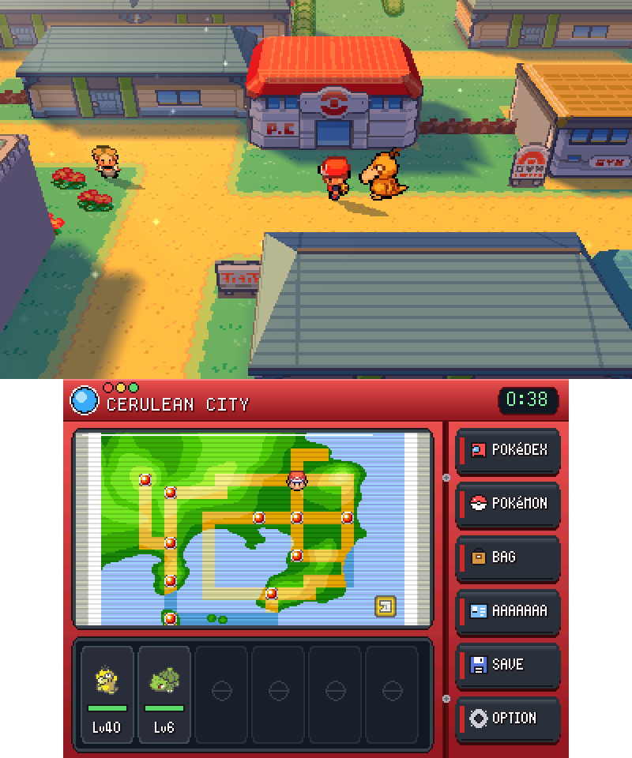
</p>

<table>
  <tr>
    <td>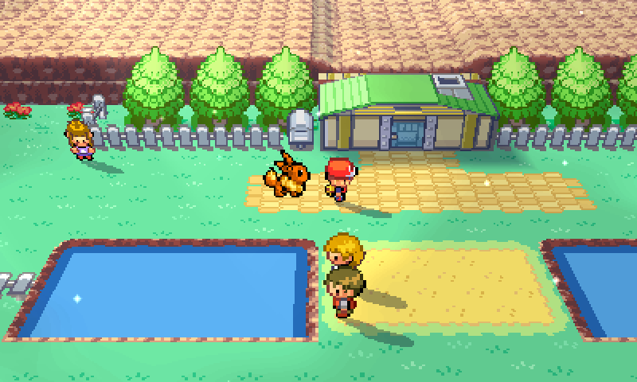<br><sub>Route 25</sub></td>
    <td>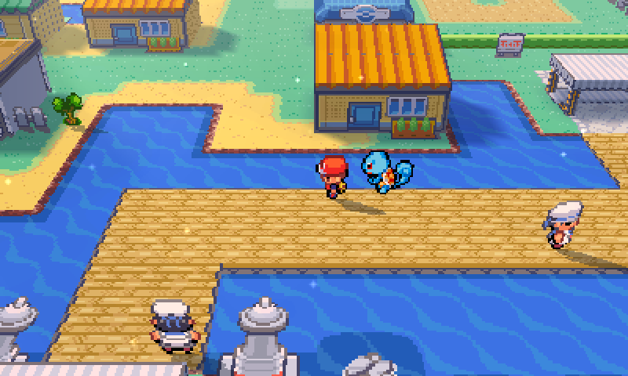<br><sub>Vermilion City, morning</sub></td>
  </tr>
  <tr>
    <td>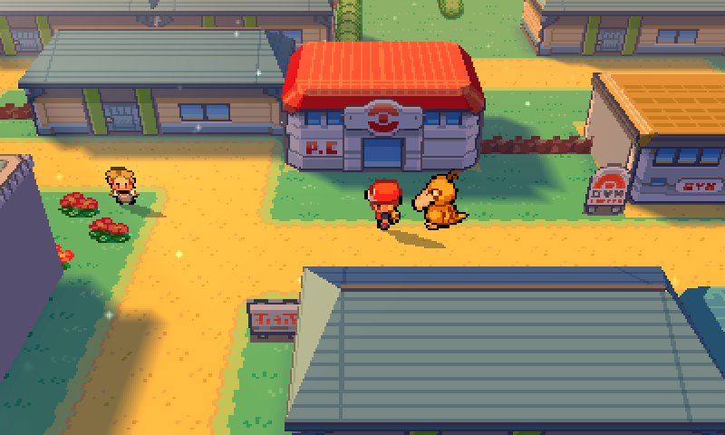<br><sub>Cerulean City, dusk</sub></td>
    <td>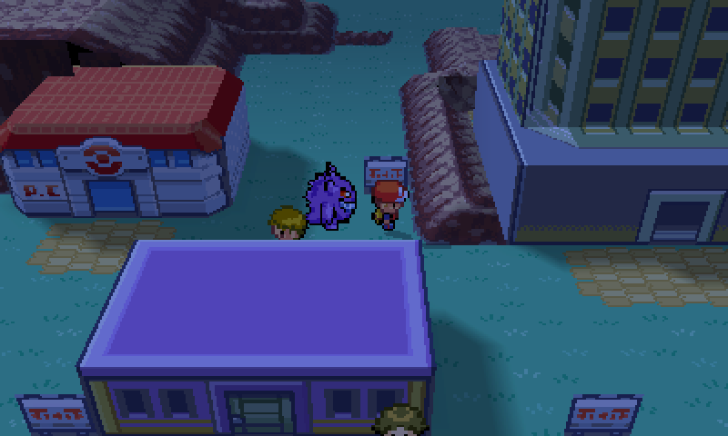<br><sub>Lavender Town, night</sub></td>
  </tr>
  <tr>
    <td>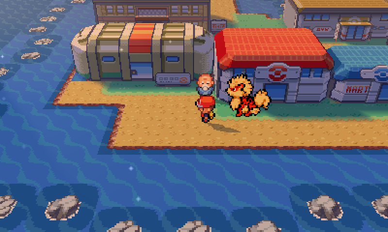<br><sub>Cinnabar Island, dusk</sub></td>
    <td>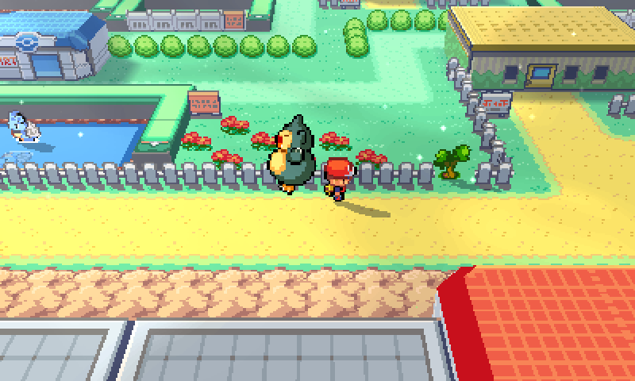<br><sub>Fuchsia City</sub></td>
  </tr>
  <tr>
    <td>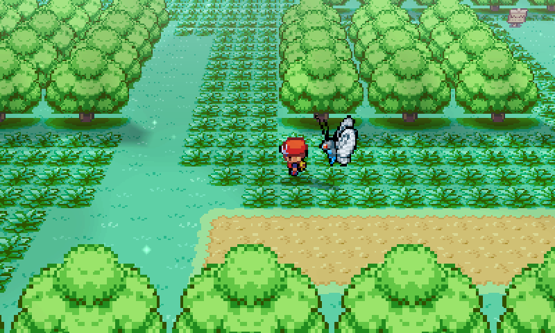<br><sub>Viridian Forest</sub></td>
    <td>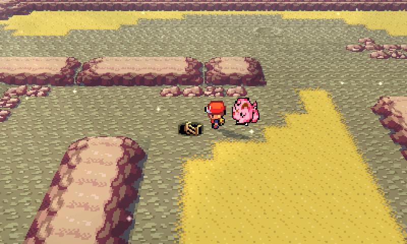<br><sub>Mt. Moon</sub></td>
  </tr>
</table>

**Day and night.** Outdoors the light follows the console's clock (or a day
that passes in 24 minutes, or stays off - OPTIONS > DAY/NIGHT):

<table>
  <tr>
    <td>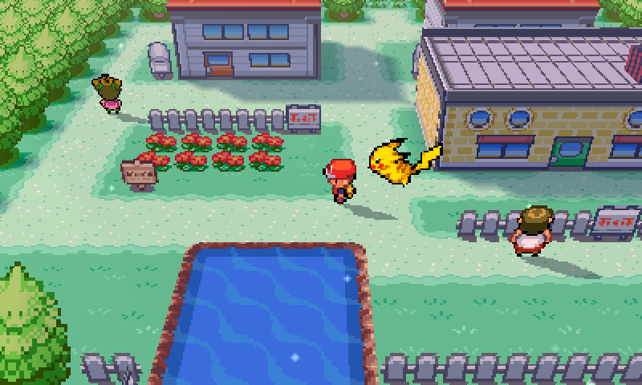<br><sub>Dawn</sub></td>
    <td>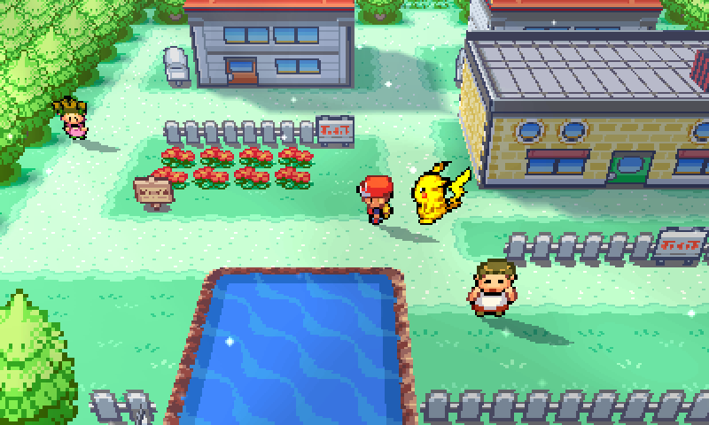<br><sub>Day</sub></td>
  </tr>
  <tr>
    <td>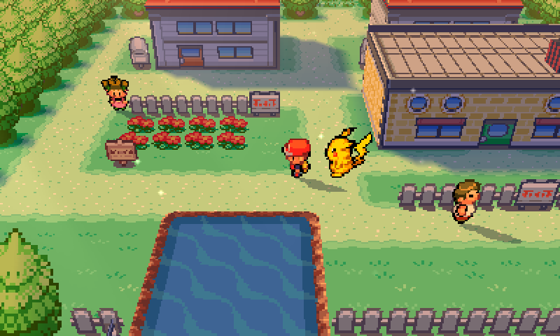<br><sub>Dusk</sub></td>
    <td>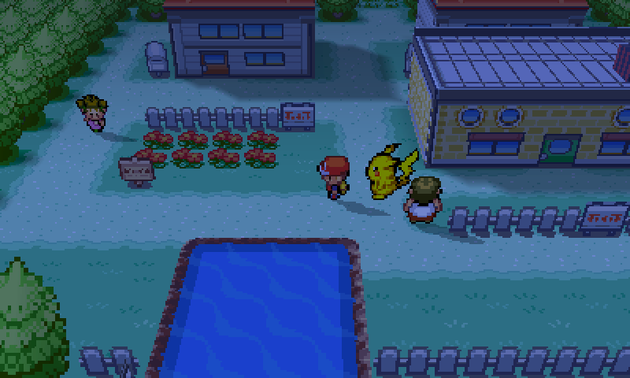<br><sub>Night</sub></td>
  </tr>
</table>

## Features

- **The whole game, native on the 3DS**, at the console's own frame rate.
- **A 3D overworld**: towns, routes, caves and interiors rebuilt in 3D from
  the game's own drawing - buildings, trees, relief, furniture - with lighting,
  shadows, a day/night cycle and an adjustable camera. The classic 2D field
  is one option away.
- **3D battles** (optional): the battle in front of the voxel world.
- **A bottom screen like a Pokédex**: region map, party, quick menu keys, the
  battle's moves and actions to touch; menus run on it while the top screen
  keeps the world.
- **Free movement** (optional): walk any way the circle pad points.
- **A Pokémon that follows you** in the 3D world: the first of your party
  walks behind you, in eight directions, in Mystery Dungeon style (see below).
- **Options**: settings, quality-of-life enhancements (game speed, exp share,
  reusable TMs, HMs without the move...) and cheats, from the bottom screen.

## Install (players)

1. Download `FireRed3DS-v<version>-Windows.zip` from the
   [Releases](../../releases) page and extract it.
2. Run `FireRed3DS-Builder.exe`, choose your ROM - Pokémon FireRed (USA,
   Rev 1), SHA-1 `dd5945db9b930750cb39d00c84da8571feebf417` - and your 3DS's SD
   card. The builder generates the game's data from your ROM on your computer
   and installs it in `/3ds/firered3ds/`. The ROM is never uploaded or copied.
3. Start the game from the Homebrew Launcher (or install
   `FireRed3DS-Forwarder.cia`, when a release has one, for a HOME Menu icon).

Needs a 3DS / 2DS family console with custom firmware (Luma3DS). Saves are in
`/3ds/firered3ds/firered3ds.sav`, in the GBA's format: the same 128 KB file
moves between the 3DS, GBA emulators and a cartridge dump. (v0.2.3 converts a
save from an earlier version once, keeping the original as
`firered3ds.sav.bak`.)

**Linux, macOS or a Chromebook (Linux).** The builder is plain Python: with
Python 3.11+ and Pillow, use the `payload` folder from the release ZIP and the
builder's sources from the same version:

```
git clone --branch v<version> https://github.com/NachoGonzalez2001/Pokemon-FireRed-3DS
cd Pokemon-FireRed-3DS/builder
python3 -m firered3ds_builder --payload /path/to/FireRed3DS-v<version>-Windows/payload     build --rom /path/to/firered.gba --output out
```

then copy `out/3ds` to the root of the SD card.

**The Pokémon that follows you.** Its sprites come from
[PMD SpriteCollab](https://github.com/PMDCollab/SpriteCollab), most of them Spike
Chunsoft's own from the Pokémon Mystery Dungeon games, so this repository and
its releases do not include them: the builder downloads them while it installs
(it needs an internet connection for that, once) and writes `followers.bin`
and `followers-credits.txt`, every artist credited, next to the game. Without
them the game works the same, without its follower; it can be turned off in
OPTIONS (3D FOLLOWER).

## Build (developers)

The source tree is the pinned decomp plus this project's patches and port:

```sh
python tools/bootstrap.py --dir C:/fr3ds/upstream     # pret/pokefirered + patches/ + 3ds_port/
make -C C:/fr3ds/upstream/3ds_port all                 # devkitARM, libctru, citro2d/3d
```

`make all` embeds the game data built from the decomp (a development build);
`make release` builds the executable alone. `tools/build_release.py` makes a
release: the recipe the builder rebuilds the data from (`tools/gen_recipe.py`),
the payload, the standalone builder and an audit that nothing from the game
is inside (`tools/release_audit.py`).

| Path | What |
|---|---|
| `patches/pokefirered/` | the changes to the decomp, one patch per topic |
| `3ds_port/` | the 3DS platform layer, renderer, voxel world and bottom screen |
| `3ds_port/scripts/` | generators of the 3D world from the game's art |
| `builder/` | the player's builder: ROM to data pack |
| `tools/` | bootstrap, patch export, release tools |

## Support the project

Pokémon FireRed 3DS is free and always will be. If you enjoy it and want to
support the time that goes into it, you can make a voluntary donation through
PayPal. Donations support development only: they do not buy the game, early
access or anything else, and the releases never include the game.

[](https://www.paypal.com/donate/?hosted_button_id=YRCM45GNZ59XW)

## Acknowledgements

Special thanks to **[ZallaxDev](https://github.com/ZallaxDev)**, creator of
[Pokémon Emerald 3Ds Dual Screen](https://github.com/ZallaxDev/pokeemerald-3Ds-dualscreen).
This project stands on that port: its 3DS platform layer, audio, bottom-screen
design, voxel renderer and tooling are where this one started, and its
approach to bringing a GBA Pokémon game to both screens of the 3DS made this
port possible.

Thanks as well to the [pret](https://github.com/pret) team for the
pokefirered decompilation.

See [NOTICE.md](NOTICE.md) for credits and licences. Pokémon FireRed 3DS is an
unofficial fan project, not affiliated with or endorsed by Nintendo, Game
Freak, Creatures or The Pokémon Company.
